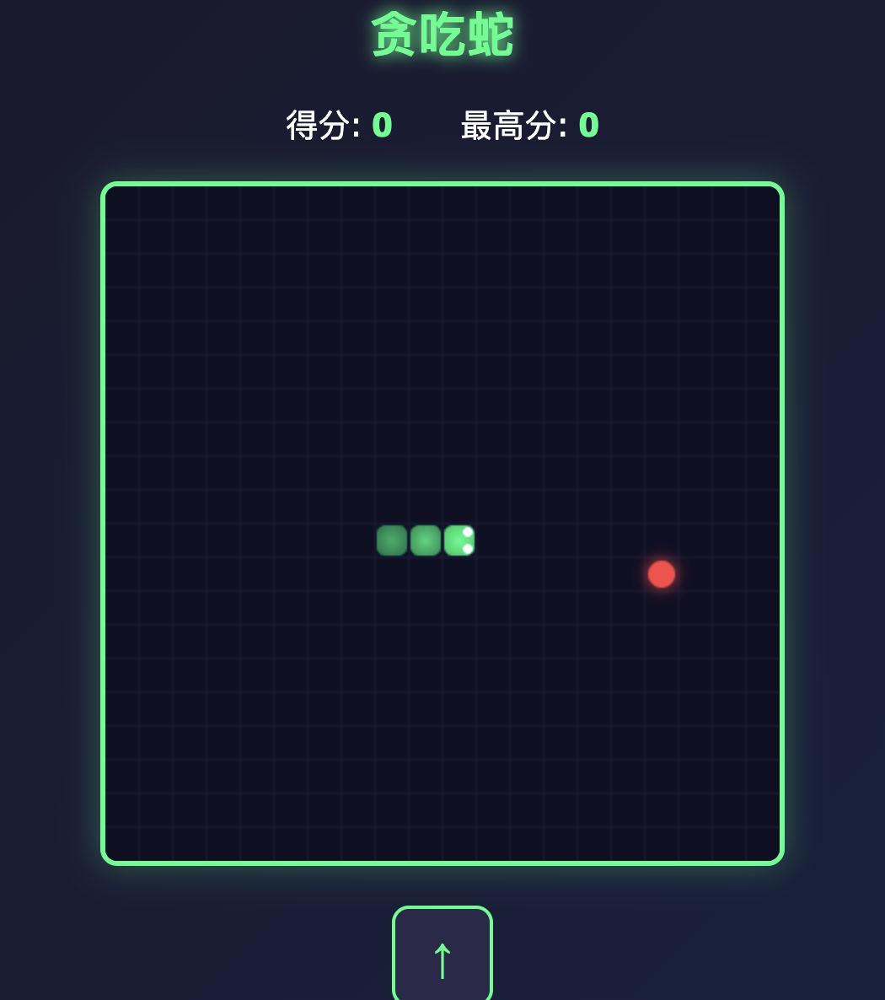

# Snake Game

A single-file browser Snake game in vanilla HTML, CSS and JavaScript. No build step, no dependencies, no framework — open `index.html` and play.

**[▶ Play in the browser](https://liuguanyi688-del.github.io/snake-game/)**



## Features

- Canvas-rendered board with a glowing neon theme.
- Arrow-key controls plus an on-screen D-pad for touch devices.
- Food spawning, score tracking and a persistent best score (`localStorage`).
- Wall and self-collision detection with a restart flow.
- Responsive layout that works on desktop and mobile.
- Entire game — markup, styles and logic — in one readable file.

## Controls

| Input | Action |
|---|---|
| ↑ ↓ ← → | Move the snake |
| Start / Restart button | Start a new round |
| On-screen arrows | Move (touch devices) |

## Run Locally

```bash
git clone https://github.com/liuguanyi688-del/snake-game.git
cd snake-game
open index.html        # macOS
# start index.html     # Windows
# xdg-open index.html  # Linux
```

Or serve it over HTTP:

```bash
python3 -m http.server 8000
# http://localhost:8000
```

## Project Structure

```text
snake-game/
├─ index.html   # markup, styles and game logic
├─ preview.png  # screenshot
└─ README.md
```

## How It Works

The game is a small fixed-timestep loop:

1. Read keyboard or touch input.
2. Advance the snake by one cell on each tick.
3. Check collisions with walls, the body and food.
4. Update the score and redraw the canvas.
5. Schedule the next tick.

## Deployment

The project is static, so it works on GitHub Pages, Vercel, Netlify or any file server. This repository is already published at <https://liuguanyi688-del.github.io/snake-game/>.

## License

[MIT](LICENSE)
